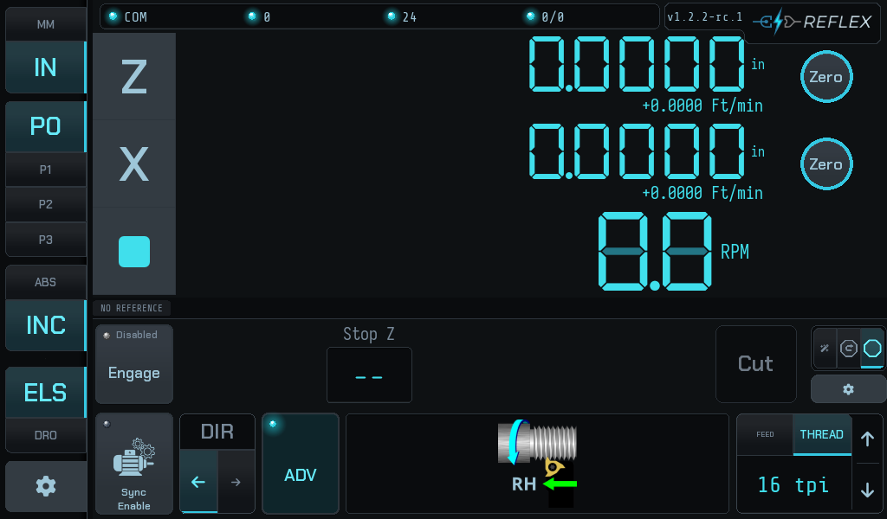

# Reflex

A **Digital Read-Out (DRO) and Electronic Leadscrew (ELS) system for manual
lathes**: an STM32-based real-time motion controller and a Kivy touchscreen UI,
talking RS-485 Modbus RTU. One system, one repository.

| Path | What it is |
|---|---|
| [`fw/`](fw/) | STM32F411 firmware: 50 kHz motion ISR, a superloop (no RTOS), Modbus RTU slave. Includes a native Linux emulator that compiles the real firmware sources against simulated lathe physics. |
| [`ui/`](ui/) | Kivy DRO/ELS touchscreen app, Modbus master: Raspberry Pi at the machine, or desktop (Windows/macOS/Linux) for development. |

**[User guide](https://funkenjaeger.github.io/reflex/)**. Installing:
[`docs/setup/installing.md`](docs/setup/installing.md). Release notes:
[`release-notes/`](release-notes/).



[](https://www.youtube.com/watch?v=38qAaq2tOGU)

## What it does

* Multi-axis DRO with configurable axes, hardware scale inputs, and transforms
* **Electronic leadscrew**: spindle-synchronized carriage feed for power feeding
  and threading
* **Automatic electronic stop** — feed or thread up to a shoulder, hands off
* **Electronic retract**, and automatic **phase re-sync to thread pitch**
  between passes (free use of the half nut between threading passes)
* **Take-up confirmation** — checks the carriage really moved before every
  pass, or refuses it
* **Pick up an existing thread**, and **widen a groove** past the tool that
  cuts it
* **Updates itself** from the touchscreen, firmware and UI together, and backs
  up its calibration to USB or a GitHub gist

The firmware owns everything real-time (encoders, step generation, the stop);
the UI owns operator workflow, configuration, and display. The wire between
them is a generated, memory-mapped register contract guarded by
`protocolVersion`.

## Project status

Reflex is tested on one lathe and is not a certified safety system. A release
may change the register contract or configuration format without a
migration: read the release notes and keep a backup before updating.

## Stop modes

The electronic **stop** is optional; disengaged, Reflex is a traditional ELS.

| Mode | What you set | Between passes |
|---|---|---|
| **Stop-only** | Stop Z | Nothing. The return and the depth of cut are yours, as with a carriage stop. |
| **Stop + retract** | Stop Z, Start Z | **Retract** returns the carriage under power, when you press it. |
| **Wizard** | Nothing typed: drive to each position and press **Set** | Runs the cycle Cut, Retract, Cut. |

> [!CAUTION]
> **Get the tool clear in X before pressing Retract** — it feeds the carriage
> back under power, and a tool still in the groove is dragged along the thread.
> Wizard mode gates the button on a committed diameter; stop + retract has none
> to compare against.

[The three stop modes, in full](https://funkenjaeger.github.io/reflex/guide/operator-modes/)

## 🗺 Versions

The living record: what shipped and what is planned, in one place so the two
cannot drift apart. Entries move from **planned** through **release candidate**
to **released** as tags are cut, and the plan is revised as often as reality
requires.

### 1.0.0 · released 2026-07-15

The first release, as two separately versioned repositories (`reflex-fw` and
`reflex-ui`). A working DRO with an electronic leadscrew behind it.

- **Multi-axis DRO** — configurable axes over hardware scale inputs, with transforms and offsets.
- **Electronic leadscrew** — spindle-synchronized carriage feed for power feed and threading.
- **Electronic stop** — feed or thread up to a shoulder and stop, hands off.
- **Electronic retract**, and the advanced ELS bar.
- Jogging with a trapezoidal velocity profile.

### 1.1.0 · released 2026-08-31

The release where the controller stops trusting and starts **verifying**.

- **Take-up confirmation** — checks the carriage really moved before every pass, or refuses it.
- **Backlash calibration** — measures take-up on the machine instead of taking a guess.
- **Thread phase re-sync from the Z scale** — open the half nut between passes.
- **Pick up an existing thread** — latch a reference on work this job did not cut.
- **Thread phase offset** — cut a groove wider than the tool, stepping phase between passes.
- **Opt-in error reporting** — no built-in destination; set `REFLEX_SENTRY_DSN`, or leave it off.
- **Half the interrupt budget back** — 50 kHz step generation, sustained ISR load 40% to 20%.
- **One repository, one version** — `fw/` and `ui/` released together, history preserved.
- **A user guide**, from installing on a Pi through to picking up an existing thread.
- Improved status indication and operator-facing messages.
- In-app update screen withdrawn; updating is a `git pull` and, when firmware moves, a flash.

### 1.2.0 · released 2026-09-25

The release where the machine **updates itself** from the touchscreen, and its
calibration survives a dead SD card.

- **In-app update, firmware and UI together** — protocol-checked, put back as it was if a step fails; offers to disengage an engaged ELS job first.
- **Field bootloader** — firmware goes over the RS-485 link, no ST-Link after the first install; runs on the board's crystal since rc.6.
- **Backup and restore** — every commissioning change recorded on the card; export to USB or sync to your own GitHub gist, and restore from either.
- **Commissioning guard** — a card that was never commissioned shows **UNCOMMISSIONED** and saves nothing until a backup is restored or the warning dismissed.
- **Generated register map** — one schema for both halves, with a protocol fingerprint; the controller is read at ~28 Hz, up from ~16.
- **Flight recorder** — the UI's poll stream and the stop's trigger instant kept on the card, so a stop can be examined afterwards.
- **Readability pass** — dimmed text meets 3:1 contrast, in both themes.
- X DRO reads radius or diameter, scales entered as a resolution, and other operator fixes.
- **Stop overshoot correction** (*experimental, off by default*) — latency in the servo drive carries the carriage past the stop; this fires the stop early by the measured overshoot. Calibrated on one lathe only.

### 1.2.1 · released 2026-09-26 — **current**

A new card's first minutes: the **UNCOMMISSIONED** dialog leads with setting up
a new machine and restores a USB or gist backup in one tap, and the app
restarts itself to load it. Firmware unchanged.

### 1.2.2 · release candidate

The machine knows what it is doing: the ELS checks the half nut and the gearbox
lever against how the carriage actually moves, and says why when it stops.

- **Coupling check** — a half nut that is not engaged, or a carriage rate that fits no gear, stops the pass (log-only until turned on).
- **Gearbox table** — the main ELS screen shows the active lever position.
- **ELS faults and refusals say why**, in short plain sentences with one thing to do.
- **Settings snapshot before every update**, so a setting an older release resets can be put back.
- Controller traffic moved off the screen's thread.

### 1.3.0 · planned — auto-start and auto-advance

Take the last button press, and then the depth of cut, out of your hands.
Auto-start was planned for 1.2.0 and moved here unbuilt.

- **Begin the pass when the half nut closes**, rather than on **Cut**.
- **Sensorless** — infers engagement from motion already measured for the take-up.
- **Advance thread phase from X depth** — a flank infeed with no compound set over: the virtual compound.
- Threading illustrations re-tooled as programmatic SVG, regenerated like the screenshots.
- Developed desk-first against the firmware emulator, with a machine window to verify.

Everything in 1.x runs on the current controller board.

### 2.0.0 · planned — the respin

The first release that needs **new hardware**, which is why it is a major
version rather than 1.4. Only work that cannot be done on the current board
goes here.

- **Control-board respin for differential encoder signalling.**
- **Register-block integrity checksum** and **index-anchored phase correction**.
- **A half-nut sensor input**, added to auto-start's sensorless detection.

> [!NOTE]
> **Multi-start is not supported, and is not yet scheduled.** It is a software
> change (phase folded modulo the lead rather than the pitch, plus a starts
> count) and does not wait for the respin. The phase offset is not a
> substitute for it either: its correction folds within one pitch and biases
> into the cutting direction, which is exactly wrong for indexing a second start.
> See [Widening a groove](https://funkenjaeger.github.io/reflex/guide/widening-a-groove/).

## Hardware

* STM32F411 board compatible with the
  [rotary-controller-pcb](https://github.com/bartei/rotary-controller-pcb)
  design (ready-made from [Provvedo](https://www.provvedo.com); no affiliation)
* RS-485 link to a Raspberry Pi 3/4/5 (e.g. via Power Hat) running the UI
* Quadrature encoders on spindle and axes; step/dir servo or stepper on the
  leadscrew

## Tests

```bash
# UI unit suites (from ui/; Linux/WSL — the venv is a Linux venv)
cd ui && uv run --frozen pytest -q

# firmware emulator suite (real firmware C against a host shim)
cmake -B fw/emulator/build fw/emulator && cmake --build fw/emulator/build -j
ctest --test-dir fw/emulator/build --output-on-failure

# full-stack system tests (the UI driving the compiled firmware emulator)
cd ui && uv run --frozen pytest -m system tests/system -q
```

The register-map contract test compares `ui/reflex/utils/devices.py` against
`fw/Core/Inc/Ramps.h` on every run.

## Deployment

Firmware and UI deploy as **separate artifacts**, so the running pair can lag
any commit; the `protocolVersion` and `diagSchema` register checks guard that
seam. An RS-485 firmware update needs no power cycle; an ST-Link flash needs a
**power cycle** before the new firmware executes. Flash
procedure: `fw/README.md`; diagnostic-probe builds: `fw/DIAG.md`.

## Provenance

Reflex is a **hard fork** of
[rotary-controller-f4](https://github.com/bartei/rotary-controller-f4) /
[rotary-controller-python](https://github.com/bartei/rotary-controller-python),
diverged for manual lathes (the originals target CNC-style rotary tables),
with no upstream tracking: [what Reflex changes](https://funkenjaeger.github.io/reflex/vs-upstream/).

## License

MIT; see `LICENSE` (and `fw/LICENSE`, `ui/LICENSE` for each half). Reflex is a fork of
Stefano Bertelli's rotary-controller projects, and those files carry his copyright line.
Bundled third-party code keeps its own license: the STM32 drivers and CMSIS
(`fw/Drivers/`) and the UI fonts (SIL Open Font License 1.1, one
`*-OFL.txt` per family in `ui/reflex/fonts/`). Issues and pull
requests are welcome.
