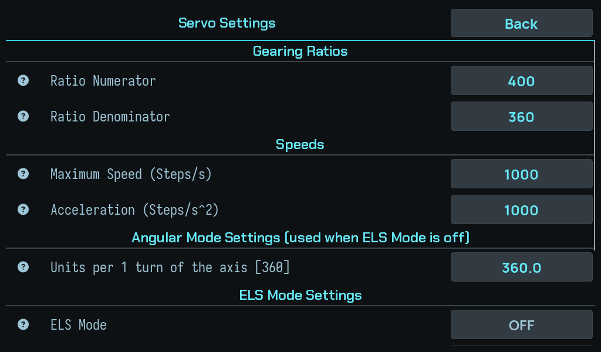

# Servo and leadscrew

Step 2 of [setup](index.md). Nothing here moves the machine, and getting it
wrong is the least visible mistake in the whole system.

## What you are setting

Three numbers that together convert **a distance** into **leadscrew steps**:

- the **leadscrew pitch** — how far the carriage travels per leadscrew turn;
- the **servo steps per revolution** — including any microstepping;
- the **gearing** between the servo and the leadscrew, if they are not direct.

If the gearing is a gearbox with more than one position, set these numbers
for one of its positions, the reference, and see
[A gearbox between servo and leadscrew](#a-gearbox-between-servo-and-leadscrew)
below.

## Why a mistake here hides

The DRO reads from the **scales**, which are independent of all three. So a
wrong servo ratio produces a machine where:

- the position on screen is correct,
- the readout tracks smoothly and plausibly,
- and every *commanded* move is wrong by the ratio.

There is no symptom on the display. The stop still fires at the right place —
the stop is enforced against the Z scale — so even threading to a shoulder looks
right. What is wrong is the size of every motion the controller generates: the
backlash take-up, the phase correction, and the retract.

!!! warning "Check it with a commanded move, measured at the part"
    Command a move of a known size and measure what the carriage actually did
    with a dial indicator. This is the only check that exercises the path the
    ratio is on. Comparing the DRO against itself proves nothing, because both
    numbers come from the scale.

## What depends on it

| | Uses the servo ratio |
|---|---|
| Backlash take-up | The distance driven before each pass. |
| Backlash calibration | The ceiling it drives to before declaring no motion. |
| Thread phase correction | The per-pass correction that keeps the tool in the groove. |
| Thread phase offset | Refuses outright if the geometry is missing or zero: *"The machine geometry that turns a distance into leadscrew steps is missing or zero. Check the servo gearing in setup."* |

That last one is the only feature that will tell you the geometry is wrong. The
others will simply be wrong by the same factor, silently.

## A gearbox between servo and leadscrew

Most lathes need nothing here: the default is **no gearbox**, and the screens
then never mention one.

If a lever or gearbox between the servo and the leadscrew changes how far the
carriage moves per motor step, enter it in **Advanced ELS settings → Gearbox table**,
the reference position first, as `name=factor` entries:

    A=1, B=2, C=1/2

That is the development lathe's gearbox, used as the example in these docs.

- 2 to 4 positions, names of your choosing, 1 to 3 characters each, with no
  spaces, commas or `=`.
- The first position is the **reference**: the servo settings above are for
  it, its factor is 1, and backlash calibration runs only there.
- Each other factor is the carriage travel per motor step relative to the
  reference, as a decimal or a fraction, between 1/8 and 8, and any two at
  least 1.2 times apart.

To measure a factor instead of typing it from the gear plate, see
[Measuring the gearbox factor](../guide/measuring-gearbox-factor.md).

Then set **Gearbox position** to the position the lever is in. The coupling
check can catch a lever moved since; see the setting's help.

---

Next: [Backlash calibration](backlash-calibration.md) — the step that moves the
machine.
